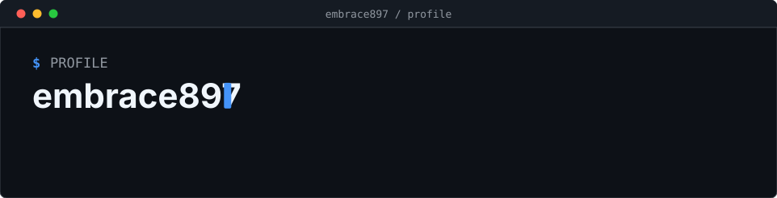
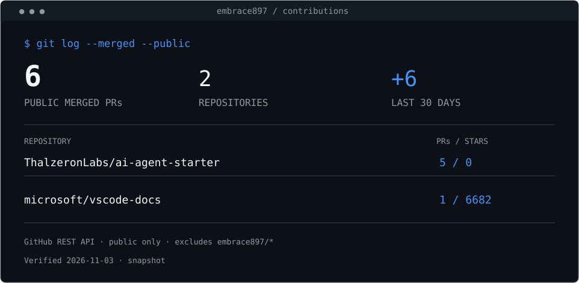

  

[软件工程开课随笔](./docs/software-engineering-reflection.md)

<!-- CONTRIB:BEGIN -->
## 公开贡献

| 仓库 | 已合并 PR | 主要内容 |
| --- | ---: | --- |
| [ThalzeronLabs/ai-agent-starter](https://github.com/ThalzeronLabs/ai-agent-starter) | 5 | 检索边界与向量维度校验、Embedding 缓存、CLI 分块配置、评测筛选和报告 |
| [microsoft/vscode-docs](https://github.com/microsoft/vscode-docs) | 1 | 修正发布说明中的拼写错误 |

- [fix: reject mismatched embedding dimensions during search](https://github.com/ThalzeronLabs/ai-agent-starter/pull/13)
- [fix: return no passages for non-positive search limits](https://github.com/ThalzeronLabs/ai-agent-starter/pull/12)
- [feat: cache chunk embeddings between index builds](https://github.com/ThalzeronLabs/ai-agent-starter/pull/11)
- [feat: expose chunk size in all CLI entry points](https://github.com/ThalzeronLabs/ai-agent-starter/pull/10)
- [feat: filter evaluation cases and print Markdown reports](https://github.com/ThalzeronLabs/ai-agent-starter/pull/9)
- [Fix typo in subsessions release notes](https://github.com/microsoft/vscode-docs/pull/10541)

统计口径

数据来自 GitHub 公开 API，核实于 2026-11-03。只统计账号提交的公开已合并 PR，排除 embrace897 名下仓库；组织归属不作推断。近 30 天按合并时间统计。Star 是仓库关注度。此处为静态快照，未启用每日刷新。ai-agent-starter 的 PR 说明披露使用 AI 辅助实现与测试，未声称账号本人另行完成手动审查。

<!-- CONTRIB:END -->
