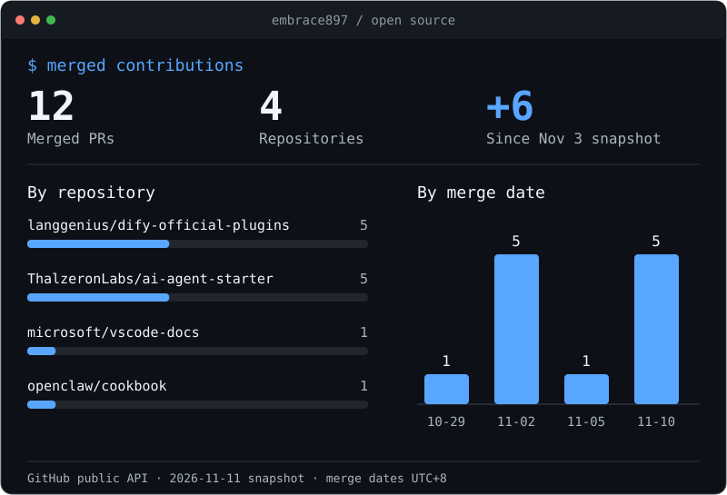

  

[软件工程开课随笔](./docs/software-engineering-reflection.md)

<!-- CONTRIB:BEGIN -->
## 公开贡献

### 最近合并

- 11-10 · [fix(openai_api_compatible): restore structured output capability](https://github.com/langgenius/dify-official-plugins/pull/4146)
- 11-10 · [fix(general_chunk): preserve Unicode fixed separators](https://github.com/langgenius/dify-official-plugins/pull/4204)
- 11-10 · [fix(json_process): retain scalar root updates in JSON Insert](https://github.com/langgenius/dify-official-plugins/pull/4201)
- 11-10 · [fix(json_process): retain values in newly created array paths](https://github.com/langgenius/dify-official-plugins/pull/4200)
- 11-10 · [fix(json_process): honor disabled path creation in JSON Insert](https://github.com/langgenius/dify-official-plugins/pull/4198)
- 11-05 · [fix: handle circular arrays in example output redaction](https://github.com/openclaw/cookbook/pull/22)

查看此前合并的 6 个 PR

- 11-02 · [feat: cache chunk embeddings between index builds](https://github.com/ThalzeronLabs/ai-agent-starter/pull/11)
- 11-02 · [feat: expose chunk size in all CLI entry points](https://github.com/ThalzeronLabs/ai-agent-starter/pull/10)
- 11-02 · [feat: filter evaluation cases and print Markdown reports](https://github.com/ThalzeronLabs/ai-agent-starter/pull/9)
- 11-02 · [fix: reject mismatched embedding dimensions during search](https://github.com/ThalzeronLabs/ai-agent-starter/pull/13)
- 11-02 · [fix: return no passages for non-positive search limits](https://github.com/ThalzeronLabs/ai-agent-starter/pull/12)
- 10-29 · [Fix typo in subsessions release notes](https://github.com/microsoft/vscode-docs/pull/10541)

统计口径

数据来自 GitHub 公开 API，核实于 2026-11-11。统计 embrace897 提交到非本人名下公开仓库的已合并 PR，按北京时间归档。新增数量以 11 月 3 日主页快照为基准。ai-agent-starter 的 PR 说明披露使用 AI 辅助实现与测试，未声称账号本人另行完成手动审查。

<!-- CONTRIB:END -->
